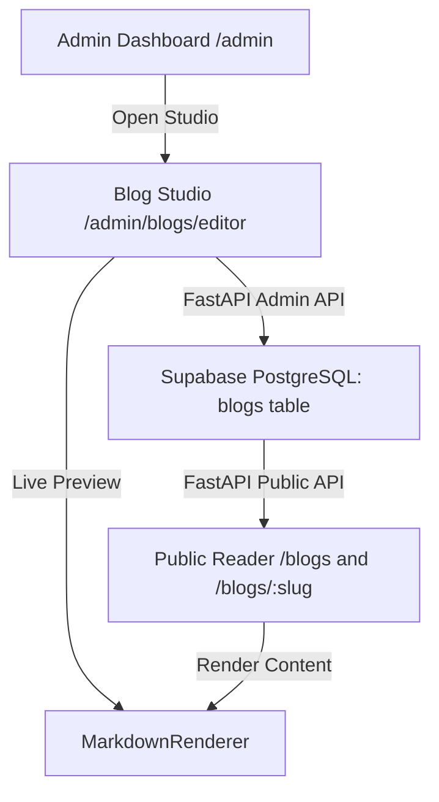

# Blog & Content Studio Architecture

## 1. System Overview

The Blog & Content Management System in the Portfolio platform provides a full-featured writing, editing, and publishing environment. It bridges technical markdown authoring with rich text formatting (tables, diagrams, callout blocks, syntax highlighting) and connects directly to the Supabase PostgreSQL backend.



---

## 2. Component Hierarchy & File Map

| Component / File | Purpose | Route / Layer |
| :--- | :--- | :--- |
| `client/app/admin/blogs/editor/page.tsx` | Full-screen Markdown Studio with live preview, toolbar, telemetry, and meta drawer | `/admin/blogs/editor` |
| `client/components/MarkdownRenderer.tsx` | Custom AST Markdown parser supporting GFM tables, GitHub callouts, and diagrams | Shared Component |
| `client/app/admin/page.tsx` | Main administrative control panel with direct Studio deep-linking | `/admin` |
| `client/app/blogs/page.tsx` | Public article catalog with search query filter and tag pills | `/blogs` |
| `client/app/blogs/[slug]/page.tsx` | Public reader page rendering full post with telemetry and share capabilities | `/blogs/[slug]` |
| `server/app/db/models.py` (`BlogModel`) | SQLAlchemy ORM definition for `blogs` table | Database Layer |
| `server/app/api/v1/public_content.py` | Public endpoints for retrieving published blogs and incrementing view metrics | Public API Layer |
| `server/app/api/v1/admin.py` | Authenticated endpoints for CRUD operations on blog posts | Admin API Layer |

---

## 3. Data Model & Database Schema

The `blogs` table is persisted in Supabase PostgreSQL via SQLAlchemy:

```python
class BlogModel(Base):
    __tablename__ = "blogs"

    id = Column(String(255), primary_key=True, index=True)   # Serves as unique slug
    title = Column(String(512), nullable=False)
    summary = Column(Text, nullable=False)
    content = Column(Text, nullable=True)                    # Full Markdown body
    cover_image = Column(String(1024), nullable=True)
    external_url = Column(String(1024), nullable=True)       # Cross-post URL
    tags = Column(JSON, default=list)                        # List of topic strings
    read_time = Column(String(50), default="3 min read")
    is_published = Column(Boolean, default=True, index=True)
    views = Column(Integer, default=0)
    published_at = Column(DateTime(timezone=True), default=lambda: datetime.now(timezone.utc))
    created_at = Column(DateTime(timezone=True), default=lambda: datetime.now(timezone.utc))
    updated_at = Column(DateTime(timezone=True), default=lambda: datetime.now(timezone.utc))
```

---

## 4. Markdown & Rich Formatting Specifications

The parser in `client/components/MarkdownRenderer.tsx` converts markdown tokens into styled Tailwind CSS elements:

1. **GFM Tables**:
   - Parses `| Col 1 | Col 2 |` syntax with separator row detection (`|:---|:---|`).
   - Renders with responsive overflow wrapping, styled headers, and alternating hover rows.

2. **GitHub-Style Callout Alerts**:
   - Supports `> [!NOTE]`, `> [!TIP]`, `> [!IMPORTANT]`, `> [!WARNING]`, and `> [!CAUTION]`.
   - Renders themed color borders, backgrounds, and designated Lucide icons.

3. **Mermaid Architecture Diagrams**:
   - Code blocks tagged ````mermaid` are dynamically rendered into interactive dark-themed SVG diagrams with tailored theme tokens (`#0e0e17` background, `#f87171` edges/borders, `#2e2e42` clusters).
   - Utilizes a module-level serialized promise queue (`safeRenderMermaid`) to prevent DOM collisions during concurrent diagram renders on complex multi-diagram technical posts.
   - Includes a visual/source code tab switcher and a one-click "Copy Spec" action.

4. **Syntax Highlighting & Code Blocks**:
   - Monospace font styling with language badge and copy-to-clipboard button.

5. **Task Lists**:
   - Supports `- [ ]` and `- [x]` checkboxes.

6. **Typography & Inline Elements**:
   - Auto-detected links with external indicator icons, bold, italic, inline code chips, and image captions.

---

## 5. Studio Features (`/admin/blogs/editor`)

The Studio interface provides:

- **Authentication Gate**: Validates administrative passkey against `/api/v1/admin/auth/verify` and persists session token in `sessionStorage`.
- **Tri-Mode Viewport**:
  - `Split View`: Synchronous 50/50 editor and live preview pane.
  - `Editor Only`: Distraction-free writing.
  - `Preview Only`: Full-width reader simulation.
- **Formatting Toolbar**: Quick-insertion buttons for Headings (H1, H2, H3), bold, italic, inline code, quotes, unordered/ordered lists, task lists, GFM tables, GitHub callouts, and Mermaid diagrams.
- **Real-Time Telemetry**: Real-time word count, character count, estimated reading time, and unsaved changes indicator.
- **Article Switcher**: Top navigation dropdown to switch between existing articles or initialize a new blank draft.
- **Metadata Drawer**: Slide-over panel to configure title, slug ID, summary, cover image with preview, tag management with suggestions, read time, and immediate publication toggle.

---

## 6. Scroll Architecture & Admin Shell Isolation

1. **Lenis Inertial Scroll Bypassing**:
   - The global `LenisProvider` automatically detects `/admin` routes via `usePathname()`.
   - On `/admin` and `/admin/blogs/editor`, Lenis is destroyed and deactivated so all textareas, modals, dropdowns, and split panes retain 100% native browser scroll behavior without wheel-event hijacking.
   - For public routes, Lenis includes a `prevent` filter callback protecting elements tagged with `data-lenis-prevent`, `.custom-scrollbar`, `textarea`, `pre`, and `code`.

2. **Admin UI Shell Isolation**:
   - `AppShell` conditionally hides public navigation artifacts on all `/admin` routes:
     - **Hamburger Corner Menu Button** (`SideNav.tsx`) is hidden.
     - **Mihir 2026 Brand Emblem** (`BrandLogo.tsx`) is hidden.
     - **Visitor AI Copilot Widget** (`AgentChatWidget.tsx`) is hidden.
     - **PageLoader** and **ScrollProgress** are hidden.
   - Any residual modal locks or `overflow: hidden` states on `document.body` are reset to clean empty strings on route entry.

---

## 7. Landing Page Thoughts Showcase (`WorksWheel` 3D Drum)

The landing page features a tactile, interactive 3D showcase component (`WorksWheel`) mounted under `client/components/ThoughtsSection.tsx` at `#thoughts`:

1. **Kinetic Drum Geometry**:
   - At rest (`turn = 0`), cards are arranged tangentially around a central title in a planar ring (`ringR = cardH * 1.14`).
   - Upon scroll or drag, the ring blossoms into a vertical 3D cylindrical drum (`drumR = cardH * 2.22`) with perspective lens (`depth = cardH * 2.7`) and lateral bow curvature (`bow = cardH * 1.82`).
   - A single normalized `turn` value is interpolated with damping ease (`EASE = 0.12`) and written directly to DOM element transforms via `requestAnimationFrame` without React re-render overhead.

2. **Lenis Integration**:
   - The wheel container is annotated with `data-lenis-prevent="true"`, ensuring vertical drag and trackpad wheel events interact directly with the 3D cylinder without triggering parent document inertial scroll snapping.

3. **Dynamic Hydration & Curated Fallbacks**:
   - On mount, `ThoughtsSection` queries `${API_V1}/public/blogs`.
   - If database articles are available, they dynamically populate the wheel's items; complementary default engineering dossiers (e.g., VESPER Swarm Architecture, GraphRAG Copilots, Barge-in) fill any remaining slots to keep the 9-slot drum complete.
   - Direct deep-links route readers to `/blogs/:slug`.

4. **Pointer Drag Threshold & Click Navigation**:
   - The stage container previously called `setPointerCapture(event.pointerId)` unconditionally during `pointerdown`. In browser DOM specs, pointer capture redirects `pointerup` exclusively to the capturing stage ancestor, aborting synthetic `click` dispatch to child elements (`<Link>` / `<a>`).
   - Resolved by introducing a 6px drag delta threshold:
     - Pure clicks (distance <= 6px) never activate pointer capture, allowing natural `click` events to fire and execute client-side `router.push(item.href)` without page reloads.
     - True drag gestures (distance > 6px) activate pointer capture dynamically for fluid 3D drum rotation and set `isDragging = true` to prevent accidental navigation on gesture completion.
     - The featured dossier title and "Read Architecture Breakdown" link in the left HUD are also interactive with `pointer-events-auto`, routing readers to the active article.

