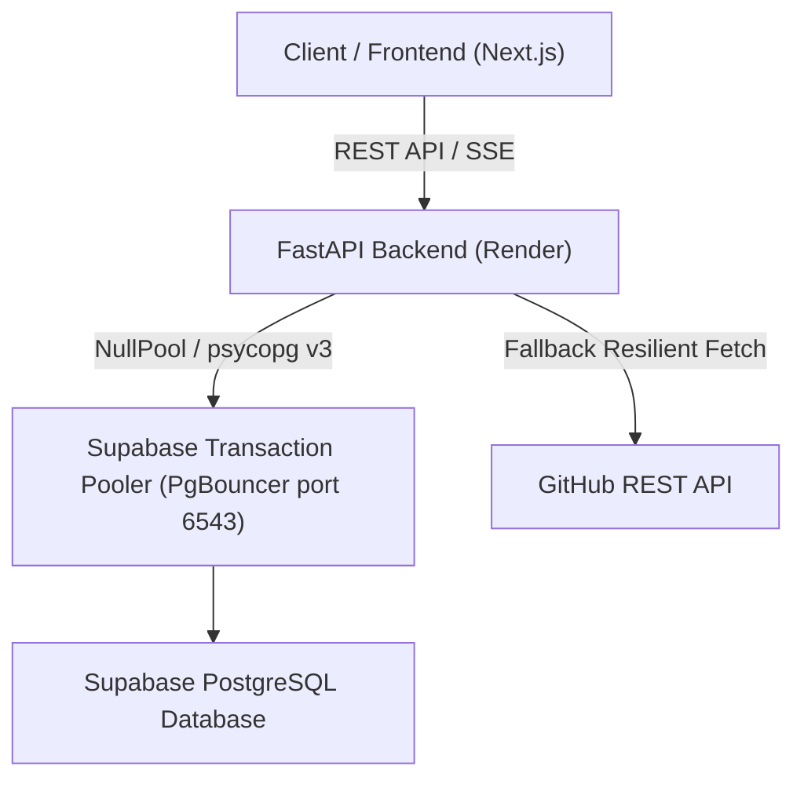

# Database and Backend Architecture Specification

## 1. System Overview

The portfolio backend is built with FastAPI, SQLAlchemy 2.0, and Supabase PostgreSQL. It manages repository indexes, engineering case studies, AST code graphs, visitor leads, achievements, and resume metadata.

---

## 2. Database Connection Architecture

### A. Driver and Dialect
- **Driver**: `psycopg` (version 3) via `psycopg[binary]`.
- **Dialect**: SQLAlchemy 2.0 default PostgreSQL dialect (`postgresql+psycopg`).
- **Connection URL Format**:
  `postgresql://postgres.<project_id>:<password>@<pooler_host>:6543/postgres`
- **URL Normalization**:
  The configuration layer normalizes legacy `postgres://` prefixes to `postgresql://` and safely preserves URL-encoded credentials (e.g., encoded quotes `%27`).

### B. Connection Pooling Strategy
- **Supabase Port 6543 (Transaction Pooler)**:
  Uses `NullPool` to prevent connection pin conflicts with external PgBouncer instances. Each query transaction opens and releases connections immediately.
- **Direct Connection / Local SQLite**:
  When running locally with SQLite or direct database connections, `QueuePool` is used with a lean connection profile (base pool size 5, max overflow 5, pre-ping validation, and 300s recycling).

---

## 3. Project Case Studies and GitHub Synchronization

### A. Data Serving Priority
1. **Primary Source (Database)**:
   Case studies stored in `project_case_studies` in Supabase (53 engineering case studies) are loaded directly.
2. **Supplemental Source (GitHub API)**:
   Any newly created or unindexed repositories discovered from GitHub are appended to the response without overwriting curated case study narratives.

### B. GitHub API Fallback Strategy
- When an authorized request to `/user/repos` encounters HTTP 401 (e.g., token expiration or scope mismatch), the system immediately falls back to `/users/{username}/repos` unauthenticated.
- This guarantees continuous availability of public project lists even if token credentials change.

---

## 4. Core Database Tables

| Table Name | Description |
| :--- | :--- |
| `project_case_studies` | Curated case study records containing architecture diagrams, performance metrics, and technical summaries |
| `repository_indexes` | AST-parsed file structures, dependencies, and code hygiene metadata |
| `repository_grades` | Code hygiene and maintainability scores calculated by the grading engine |
| `achievements` | Curated list of awards, certifications, and hackathon wins |
| `visitor_leads` | Inbound recruiter and collaboration contact messages |
| `blogs` | Engineering articles and blog post metadata |
| `resume_settings` | Resume version metadata and file byte storage |
