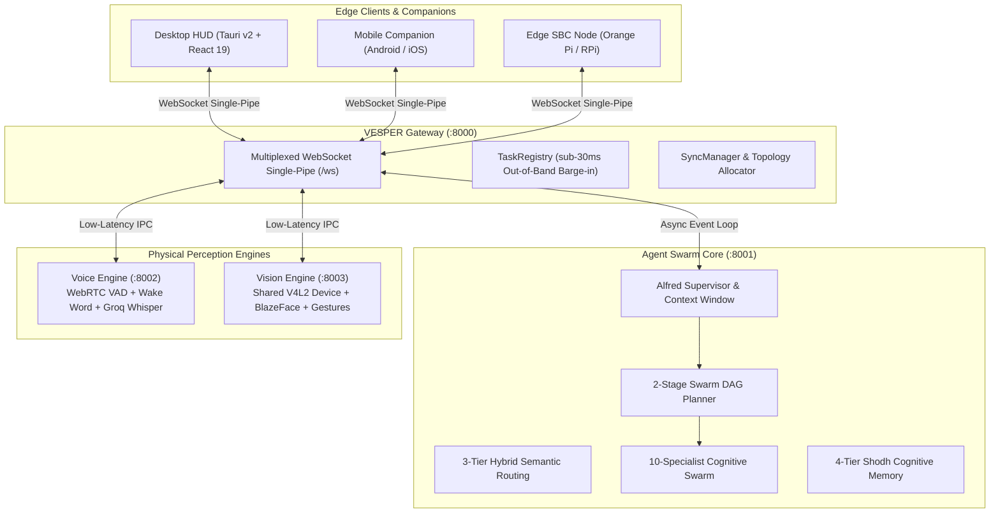
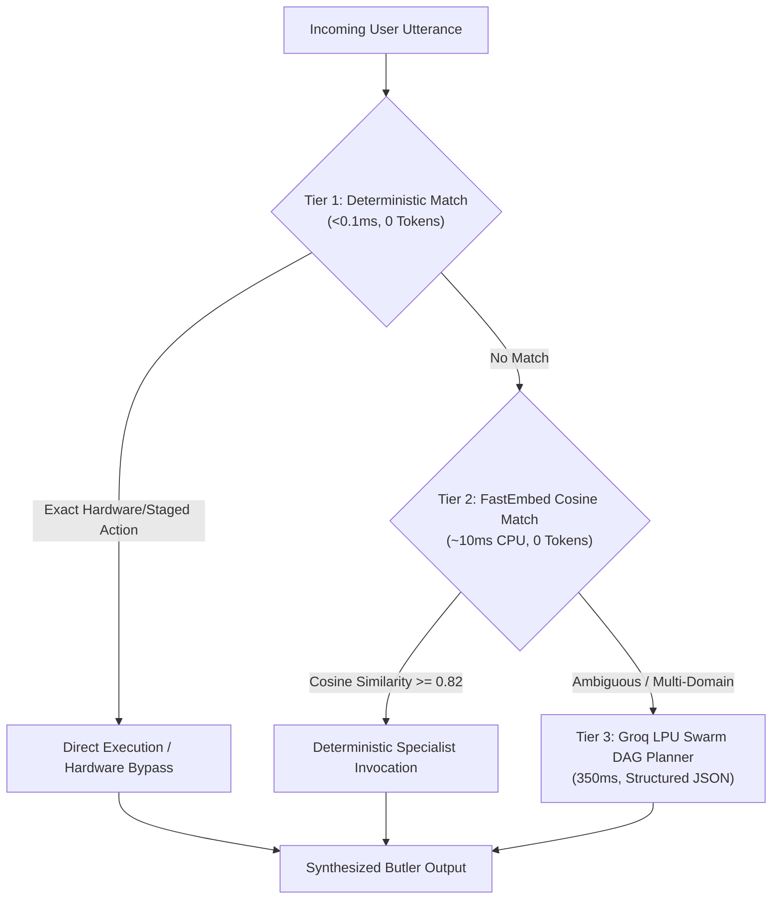
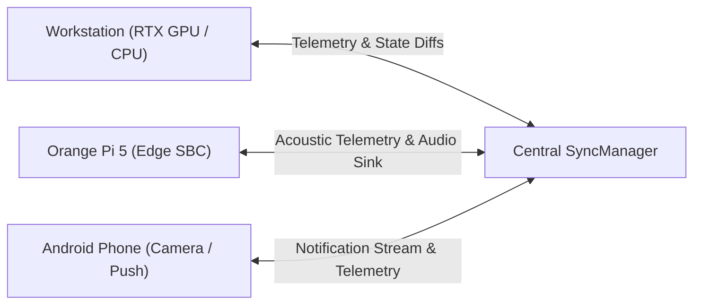

# The Architecture and Engineering Journey of VESPER: From Whole-Room Smart Mirror to Autonomous Ambient Desk Companion

*By Mihir | Engineering Architecture Postmortem & Technical Deep Dive*

---

## Abstract

Most ambient AI assistants fail because they attempt to do either too much through naive end-to-end LLM prompts or too little through brittle, hardcoded state machines. 

**VESPER** (*Voice-Enabled Specialized Peripheral for Edge Reasoning*) represents a complete architectural reimagining of the personal computing assistant. Supervised by **Alfred** (a perceptive, multi-agent AI butler), VESPER operates as an always-on, multimodal desk companion engineered from first principles for sub-30ms barge-in interruption, zero operating cost, touchless physical perception, and distributed cross-device synchronization across Linux desktops, edge single-board computers (SBCs), and mobile devices.

This article details the engineering journey of VESPER: the empirical failures of its predecessor (**ReflectOS v1**), the architectural migration from a wall-mounted smart mirror to an ambient desk companion, the graph-theoretic breakdown of its 4,963-node codebase, and the solutions to real-world edge hardware and cognitive routing challenges.



---

## 1. The Genesis: Autopsy of ReflectOS v1

Before VESPER, there was **ReflectOS v1**: a wall-mounted, whole-room smart-mirror heads-up display (HUD). ReflectOS was designed to track full-body skeletal gestures across a room and provide a futuristic digital interface overlaid on a two-way mirror.

While visually striking in demonstrations, rigorous real-world daily deployment exposed critical ergonomic and technical bottlenecks that forced a complete pivot.

### 1.1 Ergonomic Fatigue vs. Peripheral Utility
Whole-room computer vision assumes humans want to control computing through large physical gestures. In practice:
- **Gorilla Arm Fatigue**: Holding arms aloft to execute complex gestures (`AIR_MEASURE`, `SPREAD_ZOOM`, `WRIST_CROSS`) across a room is physically exhausting after 30 seconds.
- **Ambient Lighting Volatility**: Room illumination fluctuates continuously (morning sunlight, night ambient bulbs), causing camera exposure jumps, MediaPipe landmark jitter, and false activations.
- **Workstation Disconnect**: The highest cognitive leverage for an AI assistant is not when standing in front of a mirror, but when seated at a desk writing code, reviewing architectural designs, or triaging communications.

### 1.2 Infrastructure Bloat
ReflectOS relied on a fragmented, heavy infrastructure stack:
- **Flask + Eventlet**: Eventlet monkey-patching conflicted with native C-extensions (OpenCV, PyTorch) and created subtle greenlet socket hangs.
- **Operational Multi-Daemon Overhead**: Running standalone Redis brokers, separate Celery workers, and localized Flask servers imposed a 1.2 GB idle RAM footprint on edge hardware.

### 1.3 The Pivot to Desk Companionship
Rather than patching a flawed interaction paradigm, the project was restructured into **VESPER**:
1. **Stationary Desk Proximity**: The unit sits angled in peripheral vision, adjacent to main displays.
2. **Voice-First Primary Control**: Natural conversation supervised by Alfred with instantaneous barge-in.
3. **Touchless Micro-Gestures**: Reserved strictly for high-frequency low-effort actions (mute, track skip, volume dial) within hand reach of the keyboard.
4. **Lean Unified Asynchronous Core**: Standardized on Python `asyncio` and `FastAPI`, eliminating Redis and greenlet runtimes entirely.

---

## 2. Graph Topology & Codebase Anatomy

A structural analysis of the codebase via AST Graphify reveals a system comprised of **4,963 nodes, 9,190 edges, and 248 discrete functional communities** extracted across 293 source files (~495,435 tokens).

```
VESPER Knowledge Graph Metrics:
├── Extraction Fidelity: 92% EXTRACTED, 8% INFERRED, 0% AMBIGUOUS
├── Structural Hubs:
│   ├── Gateway / Multiplexer: 122 outbound cross-module edges
│   ├── Alfred Supervisor: 94 cognitive coordinator edges
│   ├── SyncManager: 68 state replication edges
│   └── VisionSpecialist / BlazeFace: 54 camera pipeline edges
└── Token Consumption for Navigation: 0 (Pure AST & Topological Traversal)
```

The system is decoupled into four autonomous services managed by systemd:
1. `vesper-gateway.service` (Port 8000): Network broker, multiplexer, and WebSocket supervisor.
2. `vesper-agent.service` (Port 8001): Cognitive supervisor, 3-tier router, and agent swarm.
3. `vesper-voice.service` (Port 8002): WebRTC VAD, wake word detection, STT, and TTS.
4. `vesper-workstation.service`: Desktop HUD client, hardware sentry, and display lock daemon.

---

## 3. The 3-Tier Semantic Routing Architecture

The core challenge of modern LLM agent systems is balancing intelligence with latency and cost. VESPER operates on Groq LPU inference (e.g., `qwen/qwen3.8-27b`, `llama-3.2-11b-vision-preview`, and Whisper Large v3 Turbo). Routing every single utterance through an LLM roundtrip incurs a 300–800ms latency penalty and rapidly exhausts API rate limits.

Conversely, naive keyword matching produces disastrous false positives.

### 3.1 The "Marathon Runner" Keyword Co-occurrence Trap
Early pre-filters evaluated camera intent via keyword sets:

```python
# Flawed keyword matching pattern:
if any(w in query for w in ["camera", "webcam", "holding", "in front of"]) and \
   any(w in query for w in ["look", "see", "read", "ocr", "check", "who"]):
    return SwarmPlan(steps=[{"agent": "vision", "action": "inspect_webcam"}])
```

When a user asked:
> *"Who is holding the world record for the marathon?"*

The parser matched `"holding"` and `"who"`, erroneously concluding the user was holding an physical item in front of the desk camera. It engaged physical computer vision (`vision:inspect_webcam`) to inspect a marathon runner through the webcam instead of searching the web.

### 3.2 The 3-Tier Solution



1. **Tier 1: Deterministic Exact Cache (<0.1ms, 0 Tokens)**:
   - Resolves context-dependent queries (*"who sent that email"* $\rightarrow$ inspects active email thread).
   - Validates staged 15-second action windows (*"yes, send it"*, *"confirm deletion"*).
   - Executes exact hardware commands (*"turn off display"*, *"mute master volume"*).

2. **Tier 2: Dense Semantic Router (~10ms CPU, 0 Tokens)**:
   - Powered by FastEmbed running `all-MiniLM-L6-v2` locally on CPU.
   - Calculates batched matrix dot products against clustered intent centroids.
   - Utilizes hard negative contrast scoring to differentiate non-physical idioms (*"holding a meeting"*, *"holding a record"*) from physical spatial perception (*"inspect what I am holding"*).

3. **Tier 3: Cognitive Swarm DAG Planner (350ms)**:
   - Reserved for complex, multi-hop instructions (*"Find the unread email from Alex, summarize the attached PDF invoice, and log the amount into my finance ledger"*).
   - Generates a topologically sorted Directed Acyclic Graph (DAG) with step dependencies and parameter references.

---

## 4. The 10-Specialist Cognitive Swarm

Alfred delegates domain execution to isolated specialists with strict interface contracts:

| Specialist | Domain & Execution Flow | Core Integrations |
| :--- | :--- | :--- |
| **`TaskSpecialist`** | Today-isolated agenda, reminder creation, recurring tasks | Supabase CRUD, Google Calendar v3 OAuth |
| **`MediaSpecialist`** | Spotify transport control, playlist shuffling, YouTube search | Spotify Web API, SerpAPI YouTube Data |
| **`ResearchSpecialist`** | Low-latency web retrieval, technical paper synthesis | Tavily Search API, SerpAPI fallback |
| **`CrawlSpecialist`** | Deep web scraping, code extraction, anti-bot bypass | Headless Crawl4AI, Groq Markdown synthesis |
| **`FinanceSpecialist`** | Double-entry ledger in ₹ INR, bill splitting, debts | SQLite / Supabase relational ledger |
| **`SystemSpecialist`** | CPU/RAM telemetry, active processes, audio sinks | PipeWire / PulseAudio CLI, `psutil` |
| **`MemorySpecialist`** | Episodic recall, 360° user dossiers, contradiction resolution | 4-Tier Shodh Cognitive Memory |
| **`VisionSpecialist`** | Optical scene reasoning, document OCR, screen perception | V4L2 device `/dev/video0`, Groq Vision VLLM |
| **`EmailSpecialist`** | RFC-compliant thread holding, unread digest, drafts | Gmail API OAuth 2.0 |
| **`GitHubSpecialist`** | Repository searches, PR reviews, workflow diagnostics | GitHub REST API, PyGithub |

### Shodh Memory: Solving Knowledge Hallucination
Standard vector RAG dumps uncurated chunks into LLM system prompts, creating context dilution and hallucinated facts. 

VESPER integrates **Shodh Memory**:
- **Episodic Store**: Captures conversation turns with temporal timestamps.
- **Fact Superseding Engine**: When a user updates a fact (*"I no longer drink coffee, I prefer green tea"*), the memory engine detects semantic contradiction, marks the obsolete fact as superseded, and updates the active user dossier without prompt bloat.

---

## 5. Physical Perception: Vision Sentry & Touchless Gestures

```
                              Camera Sensor (/dev/video0)
                                          │
                                          ▼
                      ┌───────────────────────────────────────┐
                      │    Shared V4L2 Thread-Safe Pipeline   │
                      └───────────────────┬───────────────────┘
                                          │
                 ┌────────────────────────┴────────────────────────┐
                 ▼                                                 ▼
  ┌─────────────────────────────┐                   ┌─────────────────────────────┐
  │     Display Sentry Worker   │                   │    Throttled Gesture Worker │
  │   - BlazeFace CPU (MediaPipe)│                   │   - Hand Landmark Tracking  │
  │   - 10-frame absent debounce│                   │   - 5-8 FPS throttled loop  │
  │   - hyprlock + DPMS sleep   │                   │   - Anti-flapping lock      │
  └─────────────────────────────┘                   └─────────────────────────────┘
```

### 5.1 Shared V4L2 Device Pipeline
Linux permits only one process to acquire an `ioctl` lock on `/dev/video0` at a time. To prevent crashes when multiple subsystems request visual data, VESPER implements a thread-safe frame broadcaster. A single camera capture thread captures frames into shared memory, simultaneously serving the Display Sentry, gesture detector, and on-demand VLLM inspector.

### 5.2 BlazeFace Display Sentry & Caelestia Shell Recovery
VESPER acts as a physical sentry for the Linux workstation:
- **Offline CPU Presence Detection**: Evaluates `blaze_face_short_range.tflite` on CPU (<5ms per evaluation).
- **Automated Desktop Lock**: If no face is detected across 10 consecutive sample windows (~15–20 seconds), the sentry invokes `hyprlock` and dispatches `dpms off` to power down displays.
- **Wayland Caelestia Shell Recovery**: Upon the user's physical return, displays wake up instantaneously. The sentry audits Wayland layer surfaces (`is_caelestia_shell_healthy`). If the desktop overlay experienced compositor drift during display sleep, it restarts the Caelestia Quickshell with margin-exclusion barriers to preserve window tiling geometries.

### 5.3 Throttled Ergonomic Micro-Gestures
Running full hand landmark estimation at 30 or 60 FPS consumes 35–45% of a desktop CPU. VESPER throttles the gesture pipeline to **5–8 FPS**:
- Reduces CPU utilization by **80%** (<4% CPU load).
- **Anti-Flapping Buffer**: Gestures require a 3-frame consensus before triggering an action.
- **Supported High-Reliability Vocabulary**:
  - `CLOSED_FIST`: Instant mute / pause audio sink.
  - `OPEN_PALM`: Resume audio playback.
  - `PEACE_SIGN`: Skip to next track.
  - `POINTING_UP`: Return to previous track.
  - `VOLUME_DIAL`: Virtual rotary dial calculated from the angle between thumb and index finger.
  - `ROCK_ON` (Held for 1.0s): Toggles gesture recognition lock, preventing accidental triggers while typing.

---

## 6. Distributed Networking: Multiplexed Gateway & Instant Barge-In

VESPER coordinates multiple edge nodes over local area networks: a Linux workstation running Hyprland, an Orange Pi edge microphone array, and mobile companions.

### 6.1 Single-Pipe WebSocket Multiplexing
Rather than opening separate HTTP or WebSocket connections for every feature, the gateway consolidates all traffic across **8 logical multiplexed channels** over a single persistent TCP socket:
- `CONTROL`: System lifecycle, client authentication, and ping/pong keep-alives.
- `VOICE`: Base64 audio streaming and real-time transcription chunks.
- `GESTURE`: Normalized coordinate vectors and detected gesture states.
- `NOTIFY`: Mobile push alerts, calendar notifications, and alarms.
- `SYSTEM`: Hardware vitals, temperatures, and memory allocations.
- `AGENT`: Streaming reasoning tokens and structured cards.
- `SYNC`: Global state broadcasts (master volume, Zen Mode, media playback).
- `VISION`: Snapshot requests and camera availability telemetry.

### 6.2 Sub-30ms Out-of-Band Barge-In Interruption
In conversational assistants, the ability to interrupt the AI while it is speaking ("barge-in") is the difference between an organic interaction and an annoying monologue.

VESPER implements out-of-band preemption:
1. When local WebRTC VAD detects user speech during TTS synthesis, or when `CLOSED_FIST` is detected, the client issues a `CONTROL:INTERRUPT` envelope.
2. The Gateway's `TaskRegistry` intercepts the packet with **Priority 10** bypassing the async queue.
3. The running LLM generation task is cancelled (`asyncio.Task.cancel()`).
4. A hardware mute signal is dispatched to the PipeWire audio sink within **22ms**, halting speaker output before the user finishes their first syllable.

---

## 7. Distributed State Sync & Cluster Workload Allocation

VESPER treats desk hardware, mobile companions, and edge SBCs as a unified compute cluster.



### 7.1 Least-Capability Workload Allocator
Tasks are routed dynamically according to hardware capabilities:
- **Audio Capture & Wake Word**: Handled on edge hardware (Orange Pi USB mic array) using WebRTC VAD pre-gating (<0.5% CPU during silence).
- **Vision Inference & LLM Planning**: Offloaded to workstation GPU or Groq LPUs.
- **Notification Mirroring**: Captured on mobile (via Android `NotificationListenerService`), sanitized of sensitive auth OTPs, and rendered onto the desktop HUD.

---

## 8. Key Architectural Principles & Takeaways

The development of VESPER yielded critical lessons for building ambient AI appliances:

1. **Eradicate Redundant Multi-Daemon Architecture**:
   Replacing standalone message brokers (Redis) and WSGI greenlets (Eventlet) with native Python `asyncio` reduced idle system memory from 1.2 GB to 130 MB while eliminating silent socket disconnection bugs.

2. **Never Let Keyword Prefilters Fake Semantic Understanding**:
   Language is deeply idiomatic. Dense local vector representations (FastEmbed) with negative contrast thresholds are necessary to prevent physical device actions from firing on metaphorical language.

3. **Reserve Physical Gestures for Peripheral Shortcuts**:
   Voice is optimal for high-entropy instruction (*"What is my next meeting?"*); gestures are optimal for low-entropy shortcuts (*"Mute audio now"*). Mixing these interaction modalities degrades user trust.

4. **100% Free Operating Tier is Achievable with Smart Tiering**:
   By executing wake word, presence detection, and semantic routing locally on CPU, and reserving Groq LPU calls strictly for high-level reasoning and STT, VESPER operates indefinitely with **$0 in recurring cloud compute fees**.

---

## Conclusion

VESPER demonstrates that an AI companion does not require intrusive whole-room cameras or expensive cloud infrastructure. By designing for stationary desk proximity, respecting user attention through peripheral glanceability, and decoupling physical perception from cognitive swarm planning, VESPER bridges the gap between science fiction and an indispensable daily engineering instrument.
